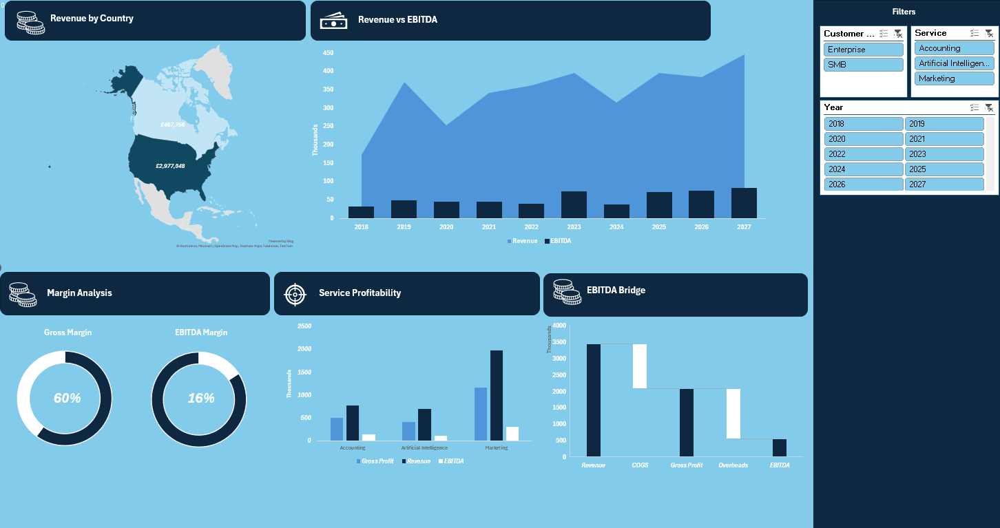

# Financial Performance Dashboard (Excel)

Interactive Excel dashboard that consolidates country-level financial models for a fictional consulting firm (USA & Canada, 2018–2027) into one view of revenue, margins, and EBITDA.

## Situation
**Case study:** A fictional consulting firm builds its financial models separately for each country and never consolidates them. Leadership has no single view of performance, which makes it hard to:
- See how revenue and profit split by country, service line, and customer type
- Understand which cost lines (COGS vs. overheads) drive EBITDA
- Spot underperforming service lines early

## Task
Consolidate the country-level models into one interactive Excel dashboard that tracks 10 years of performance and highlights where the business should act.

## Action
- Consolidated the USA and Canada financial models into a single input table using **INDEX/MATCH** and **VLOOKUP** with concatenated lookup keys (country + year + service)
- Built **Pivot Tables, Pivot Charts, and slicers** (Year, Service, Customer Type) for:
  - Revenue by country (map)
  - Revenue vs. EBITDA trend (2018–2027)
  - Service-line revenue, gross profit, and EBITDA
  - EBITDA bridge: Revenue → COGS → Gross Profit → Overheads → EBITDA
  - Gross margin and EBITDA margin KPIs
- **Validated outputs and fixed a calculation error:** the gross margin was originally calculated against (Revenue − EBITDA) instead of revenue, reporting 42% instead of the true 60%. Rebuilt it with a calculated **COGS** pivot field.

## Results
- **Overall:** £3.44M revenue over 10 years, 60% gross margin, 16% EBITDA margin; the USA generates 86% of revenue.
- **Key risk — Marketing, 2024:** the largest service line (57% of revenue)
  - Revenue down **25%** (£264K → £199K)
  - COGS up **26%** (£79K → £100K)
  - Gross margin falls from **70% to 50%**; EBITDA down **61%**
- **Insight:** overheads actually fell 40% that year, so the problem is the cost of delivery, not overhead. Recommendation: review Marketing's pricing and delivery costs rather than cut overhead.

## Next Steps
- Add a Country slicer to compare service profitability and the EBITDA bridge between the USA and Canada
- Identify the year / service / country combinations with the highest margins and what drives them

## Files
| File | Description |
|---|---|
| `Excel_Project_Raw_Data.xlsx` | Full workbook: dashboard, input data, USA & Canada financial models, margin table |
| `dashboard.png` | Dashboard screenshot |

## Tools
Excel · INDEX/MATCH · VLOOKUP · Pivot Tables · Pivot Charts · Calculated Fields · Slicers
